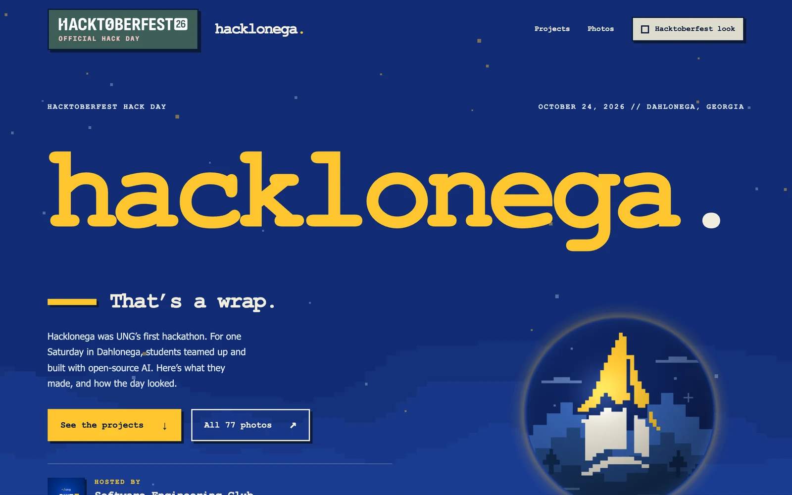
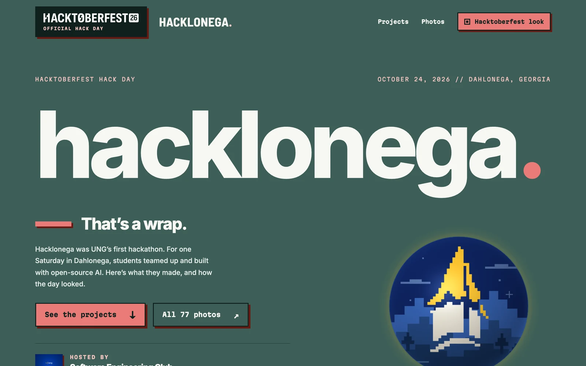
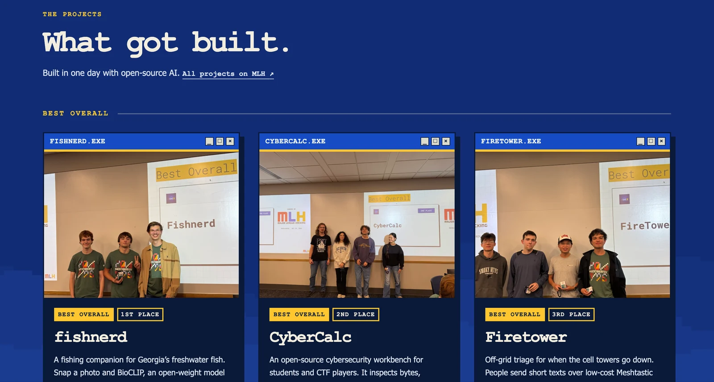
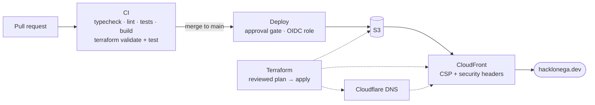

<div align="center">

# hacklonega.

**The website for Hacklonega, the University of North Georgia's first hackathon.**

An official Hacktoberfest 2026 Hack Day, powered by MLH and hosted by the UNG Software Engineering Club in Dahlonega, Georgia on October 24, 2026.

[**hacklonega.dev**](https://hacklonega.dev/) · [Projects on MLH](https://www.mlh.com/events/hacktoberfest-hack-day-dahlonega-x-univ-north-georgia/submissions) · [Photos](https://majorleaguehacking.smugmug.com/Event-Photos/Hacktoberfest-2026/Hacktoberfest-hack-day-dahlonega-x-univ-north-ge-b19f118e8e/n-rM8cB6)

 

</div>

## About

The site launched as the event's landing page. Now that the hackathon is over, it's the event's recap: what students built and the awards they won, photos from the day, and thanks to MLH and the partners. It borrows its look from the countdown screens shown at the opening and closing ceremonies ([hacklonega-countdown](https://github.com/Software-Engineering-Club-UNG/hacklonega-countdown)).



## Highlights

- **A stress ball you can throw.** On desktop, the steeple artwork becomes a WebGL sphere. Squeeze it, spin it, or pull it out of its socket and fling it around the page: it bounces off the edges of the screen and flies home when you leave it alone. The shaders, quaternion rotation and spring physics are written by hand with no 3D library, and the motion math is unit tested.
- **Two looks, one stylesheet.** A pixel-wipe transition swaps the club's Typewriter look for the Hacktoberfest 2026 look. Every color and font is a CSS custom property, so the second look is just a set of token overrides.
- **Fast and findable.** The React app is prerendered into static HTML with schema.org Event data, so crawlers and link previews get the full page. The only runtime dependencies are React and self-hosted fonts.
- **Locked-down headers.** CloudFront sends a strict Content Security Policy (`default-src 'none'`, no inline scripts or styles, no third-party origins), plus HSTS and the other standard security headers. Terraform tests check the policy on every pull request.
- **Infrastructure as code.** S3 behind CloudFront with origin access control, an ACM certificate, a CloudFront Function for the canonical-host redirect, Cloudflare DNS and an AWS budget alert, all in Terraform.
- **Keyless, reviewed deploys.** GitHub Actions reach AWS through OIDC roles, so no AWS keys are stored anywhere. Only the build from a green CI run on `main` deploys, behind an approval gate. Infrastructure plans are fingerprinted, and apply refuses anything but the plan that was reviewed.
- **Privacy by default.** No analytics, accounts, forms or cookies. Event photos are stripped of all metadata, including location.

## How it ships



## Stack

| | |
| --- | --- |
| Frontend | React 19, TypeScript, Vite 7, hand-written CSS, WebGL |
| Hosting | AWS S3, CloudFront, ACM, CloudFront Functions |
| DNS | Cloudflare |
| Infrastructure | Terraform, with offline tests on mock providers |
| CI/CD | GitHub Actions, AWS OIDC, environment approvals, Dependabot |

## Repository

| Path | What's there |
| --- | --- |
| [`CodeHawks-FrontEnd/`](CodeHawks-FrontEnd/README.md) | The site: React app, prerender script, tests and public assets |
| [`infra/site/`](infra/site) | Hosting, DNS and security headers |
| [`infra/bootstrap/`](infra/bootstrap) | Terraform state bucket and the GitHub OIDC roles |
| [`.github/workflows/`](.github/workflows) | CI, site deploys and infrastructure plan/apply |
| [`docs/RUNBOOK.md`](docs/RUNBOOK.md) | Setting it all up from an empty AWS account |
| [`docs/ASSET-PROVENANCE.md`](docs/ASSET-PROVENANCE.md) | Where every logo, photo and piece of artwork came from |
| [`CodeHawks-Backend/`](CodeHawks-Backend/README.md) | Why a static site has no backend |

## Run it locally

```sh
cd CodeHawks-FrontEnd
npm ci
npm run dev
```

`npm run typecheck`, `npm run lint`, `npm test` and `npm run build` are the same checks CI runs. [PLAN.md](PLAN.md) has the original three-phase plan the site was built from.

## Credits

Hosted by the [Software Engineering Club](https://github.com/Software-Engineering-Club-UNG) at the University of North Georgia. Thanks to [Major League Hacking](https://mlh.io/) for the Hackathon in a Box, the Arduinos and fanny packs, and basically everything else the day ran on. Site by [Israel Jauregui](https://github.com/Israel-Jauregui).

Hacktoberfest, MLH, Snowflake and DigitalOcean marks belong to their owners and are used here only to credit the event's program and partners.
